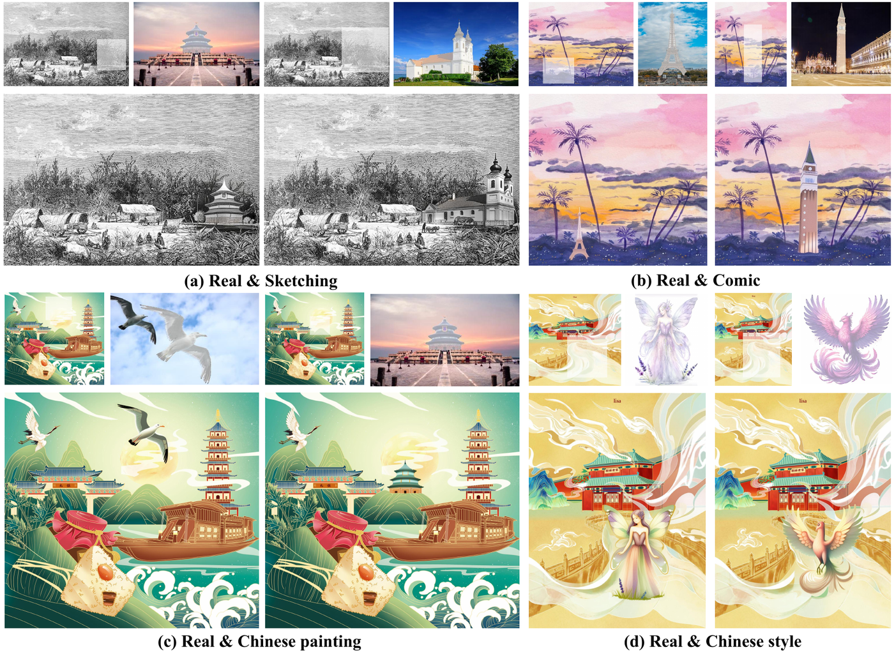
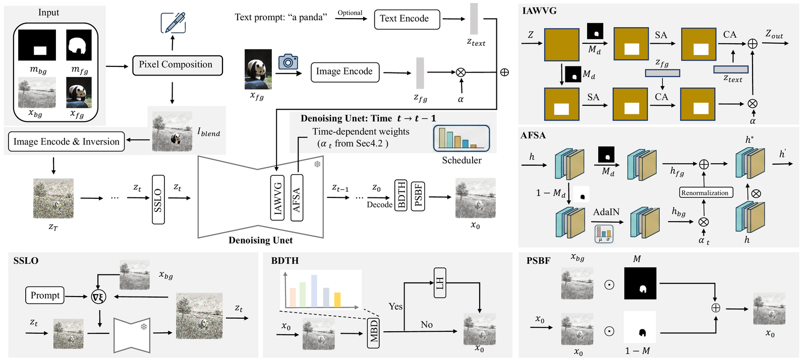

# CSCD: Content-Style Consistent Diffusion for Cross-Domain Image Composition

<a href='https://github.com/sqsiqi/CSCD'></a>
<a href='#'></a>

<p align="center">
  
</p>

CSCD is a training-free framework for cross-domain image composition. Given a
reference object and a target background from a different visual domain, it
inserts the object so that it looks native to the scene, remains recognizable,
and leaves the background unchanged.

The method separates the composition constraints and enforces each one in the
representation where it is best defined: identity in foreground-restricted
cross-attention, style in mask-guided self-attention statistics, semantics in a
narrow latent window, tone in pixel space, and background fidelity by direct
pixel fusion. This avoids the identity-style trade-off of methods that balance
all goals in a single latent representation.

<p align="center">
  
</p>

## News

- **Code release (pre-submission).** This repository currently provides the data
  interface, model loading, inversion, and a runnable
  pipeline skeleton. The core modules (IAWVG, AFSA, SSLO, BDTH, and PSBF) are
  temporarily withheld and will be released upon paper acceptance.
- The paper is under review. The arXiv/paper link will be added here.

## Installation

```bash
conda create -n cscd python=3.10 -y
conda activate cscd
pip install -r requirements.txt
```

The code is tested with PyTorch 2.x and Diffusers 0.29+.

## Download Models

Place the models under `checkpoints/` (or pass their paths on the command line):

- [stabilityai/stable-diffusion-xl-base-1.0](https://huggingface.co/stabilityai/stable-diffusion-xl-base-1.0)
- [h94/IP-Adapter](https://huggingface.co/h94/IP-Adapter) (`ip-adapter_sdxl.bin`)
- [openai/clip-vit-large-patch14](https://huggingface.co/openai/clip-vit-large-patch14)
- [VGG19](https://download.pytorch.org/models/vgg19-dcbb9e9d.pth) (used by the
  full model for VGG feature extraction)

The repository does not redistribute model weights.

## Data Preparation

Each sample is a folder with four files:

```text
example/
├── background_image.png   # target background
├── background_mask.png    # placement mask (white = insertion region)
├── ref_image.png          # reference foreground image
└── ref_mask.png           # reference foreground mask (white = object)
```

`examples/` contains two samples in this format. The placement mask defines
where the object is inserted; the reference mask defines which part of the
reference image is the object. Both masks are binary images.

An optional prompt can be supplied on the command line. The method also works
without a prompt; the reference supplies content and the background supplies
style.

## Running

```bash
python scripts/run_demo.py \
  --input examples/example_seagull \
  --output outputs/seagull \
  --prompt "a seagull"
```

The demo loads the models, prepares the masks, builds the initial blend, and
runs the pipeline. Until the core modules are released, the pipeline stops at
`cscd/core/` with a clear message. The data interface, inversion, and
post-processing utilities are fully available.

The configuration used in the paper is in `configs/default.yaml`.

Evaluation details are described in the paper.

## Method

A high-level description of the five stages and the design rationale is in
[`docs/METHOD.md`](docs/METHOD.md). The technical details and the full
experimental results are in the paper.

## Citation

If you find this work useful, please cite:

```bibtex
@article{si2026cscd,
  title   = {Content-Style Consistent Diffusion for Cross-Domain Image Composition},
  author  = {Si, Qi and Zhang, Zhao and Zhao, Yang and Zhao, Zhongqiu and Zhang, Haijun and Wang, Meng},
  journal = {arXiv preprint},
  year    = {2026}
}
```

The entry will be updated when the paper is available.

## Acknowledgments

This codebase is built on [Diffusers](https://github.com/huggingface/diffusers),
[IP-Adapter](https://github.com/tencent-ailab/IP-Adapter), and the public
AIComposer codebase. We thank the authors for making their code available.

## License

MIT License. See [LICENSE](LICENSE).

## Contact

Qi Si (`shardenq@gmail.com`), Zhao Zhang (`cszzhang@gmail.com`).
